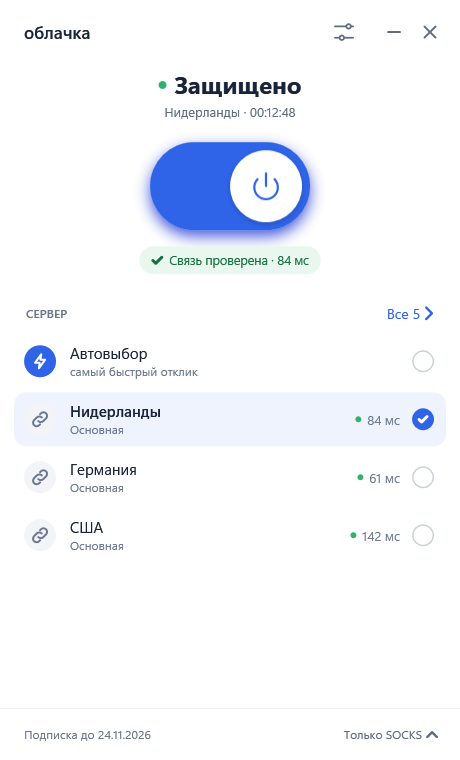
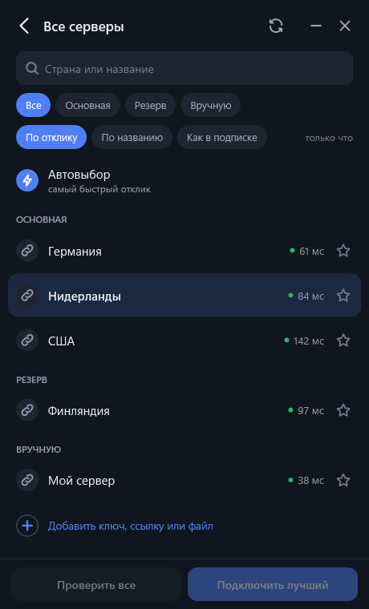
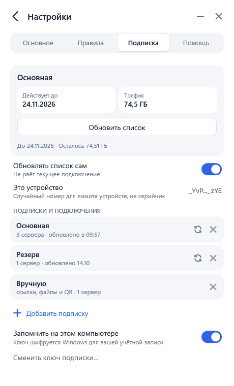
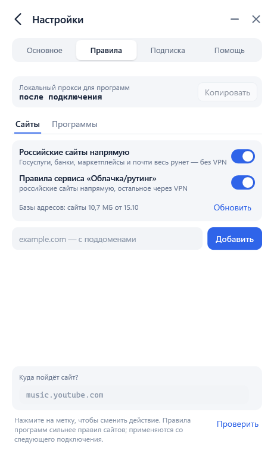

<div align="center">

# ☁️ Облачка

**VPN-клиент для Windows: вставьте ключ — и всё готово**

Xray и sing-box внутри, подписки любого сервиса, маршрутизация сайтов и программ, защита от утечек

[](LICENSE)


[](https://github.com/radiypoloniy/oblachkavpn/releases)

&nbsp;&nbsp;

</div>

## Зачем

Обычные клиенты вроде v2rayN или Throne мощные, но требуют разбираться в ядрах, JSON и маршрутах. Облачка делает то же самое за одну кнопку:

- вставили ссылку подписки — серверы появились, самый быстрый выбран;
- нажали переключатель — подключено, связь проверена;
- если сервер пропал — клиент сам переключится на рабочий;
- если что-то сломалось в сети Windows — найдёт и починит.

## Возможности

**Подключение**
- Два режима: **«Браузеры и программы»** (системный прокси) и **«Весь компьютер»** (TUN, весь трафик через VPN).
- **Защита от утечек**: в режиме «Весь компьютер» фильтры Windows (WFP) не выпускают трафик мимо туннеля, даже если ядро упало.
- **Автовыбор**: пингует серверы и подключается к самому быстрому, при обрыве переходит на рабочий.
- Сеть всегда возвращается в исходное состояние: после выхода, сбоя или перезагрузки.

**Подписки и серверы**
- Подписки любого сервиса: Base64-список ссылок, Xray JSON, sing-box JSON, Clash / Mihomo YAML.
- Протоколы: **VLESS** (TCP, XHTTP, WebSocket, gRPC, HTTPUpgrade; TLS и REALITY), **Trojan**, **Hysteria2**.
- **Несколько подписок сразу**: у каждой своя вкладка, как в Throne. Отдельные ссылки собираются во «Вручную».
- Трафик и срок подписки, резервные адреса подписки, автообновление.
- Добавление по ссылке, файлу, **QR-коду с экрана** и ссылкам `oblachka://` из браузера.
- **Перенос из других клиентов** при первом запуске: Happ, Throne, Hiddify, v2rayN, NekoBox, v2RayTun, FlClash, Clash Verge.

**Маршрутизация**
- «Российские сайты напрямую» в один клик, по спискам geosite/geoip.
- Свои правила для сайтов: напрямую, через VPN или заблокировать.
- **Правила для программ** с выбором из списка установленных: Telegram через VPN, игры напрямую. Поиск по названию, в том числе русскими буквами.
- Правила маршрутизации сервиса (формат Happ) применяются автоматически.

**Помощь**
- **«Сеть Windows»**: находит то, что ломает интернет, — брошенный прокси от упавшего клиента, «мёртвый» DNS, работающий zapret, записи в hosts, — и исправляет с возможностью вернуть как было.
- Обезличенный отчёт диагностики: без ключей, адресов и истории сайтов.
- Светлая и тёмная тема, трей с быстрой сменой сервера.

<table>
<tr>
<td align="center"><br><sub>Первый запуск и перенос</sub></td>
<td align="center"><br><sub>Несколько подписок</sub></td>
<td align="center"><br><sub>Правила сайтов</sub></td>
<td align="center"><br><sub>Починка сети Windows</sub></td>
</tr>
</table>

## Установка

1. Скачайте `Oblachka-setup-….exe` со страницы [Релизы](https://github.com/radiypoloniy/oblachkavpn/releases).
2. Запустите. Установщику нужны права администратора: он ставит сетевую службу для режима «Весь компьютер».
3. Программа пока не подписана, поэтому Windows может показать «Windows защитила ваш компьютер». Нажмите **«Подробнее» → «Выполнить в любом случае»**. Сверить файл можно по SHA256 из описания релиза.

Требования: Windows 10 (1809+) или Windows 11, x64. Ставить .NET не нужно, он внутри.

## Как пользоваться

1. Вставьте ссылку подписки или ключ на первом экране. Если подписка уже есть в другом клиенте, нажмите её в списке «Перенести из другого приложения».
2. Нажмите переключатель. Сервер по умолчанию — «Автовыбор».
3. Режим меняется внизу главного экрана: «Браузеры и программы» или «Весь компьютер».
4. Правила сайтов и программ — в «Настройки → Правила».

Если интернет не работает даже без VPN, откройте «Настройки → Помощь → Сеть Windows».

## Конфиденциальность

- Подписки и настройки хранятся только на вашем компьютере и зашифрованы средствами Windows (DPAPI) для вашей учётной записи.
- Клиент ходит в сеть только к вашей подписке, к выбранным серверам и, по нажатию, за базами маршрутизации и флагами стран.
- Сервису подписки передаются случайный идентификатор устройства, версия Windows и модель компьютера. По ним работает лимит устройств в панелях вроде Remnawave. Серийных номеров и личных данных в запросе нет.
- Никакой телеметрии и аналитики нет.

## Сборка из исходников

```powershell
git clone https://github.com/radiypoloniy/oblachkavpn.git
cd oblachkavpn
.\build.ps1              # скачает ядра (SHA256 сверяется) и соберёт out\app
.\test.ps1               # ~240 проверок: разбор, сеть, служба, интерфейс
.\build-installer.ps1    # установщик в dist\ (нужен Inno Setup 6)
```

Нужен [.NET SDK 10](https://dotnet.microsoft.com/download/dotnet/10.0). Подробности — в [docs/development.md](docs/development.md).

## Структура репозитория

```text
src/
  App/            точка входа, ссылки oblachka://, пути данных
  Window/         главное окно по частям (подключение, импорт, серверы, правила, трей)
  Views/          экраны в XAML
  UI/             диалоги, темы, флаги
  Profiles/       ссылки, подписки, группы, сохранение, перенос из других клиентов
  Core/           управление ядрами Xray / sing-box, пинг, автовыбор
  Routing/        правила сайтов и программ, geosite / geoip
  Network/        сетевая служба, TUN, защита WFP, системный прокси
  NetworkDoctor/  проверка и починка сети Windows
  Qr/             распознавание QR-кодов
tests/            самопроверки и стенды (Oblachka.Tests.exe)
installer/        сценарий Inno Setup
scripts/          загрузка ядер и проверки кода
vendor/           лицензии и происхождение ядер
docs/             документация
```

## Документация

- [Как устроена Облачка](docs/architecture.md)
- [Разработка, сборка и проверки](docs/development.md)
- [Сетевая служба и граница доверия](docs/network-service.md)
- [Установщик](docs/installer.md)

## Лицензия

Код Облачки распространяется по лицензии [GNU GPL v3](LICENSE).

Внутри используются [Xray-core](https://github.com/XTLS/Xray-core) (MPL-2.0) и [sing-box](https://github.com/SagerNet/sing-box) (GPL-3.0). Версии, контрольные суммы и лицензии — в [THIRD-PARTY.md](THIRD-PARTY.md).
