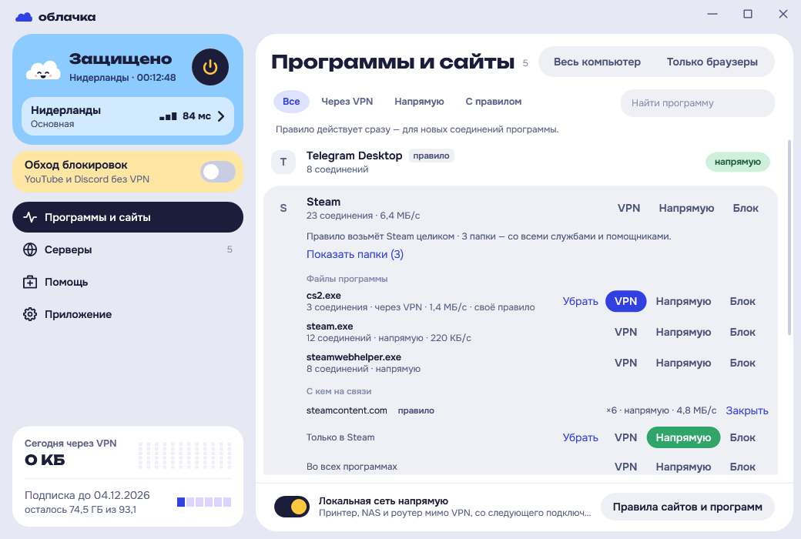
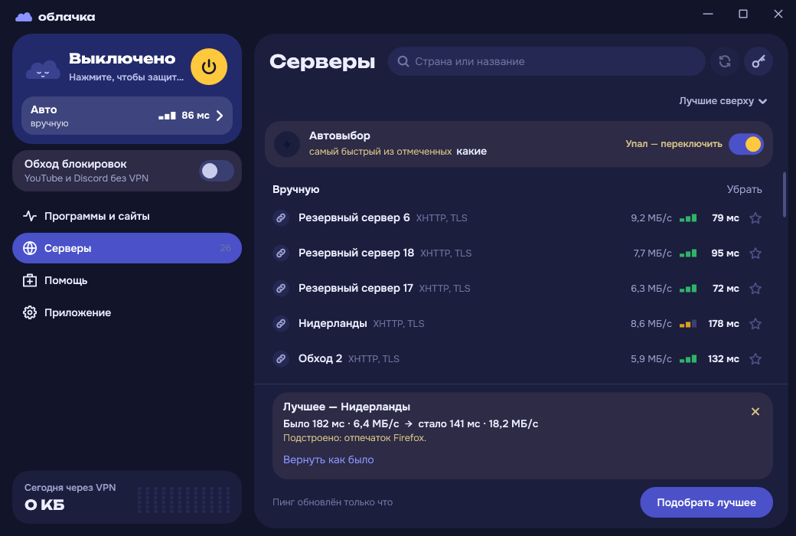
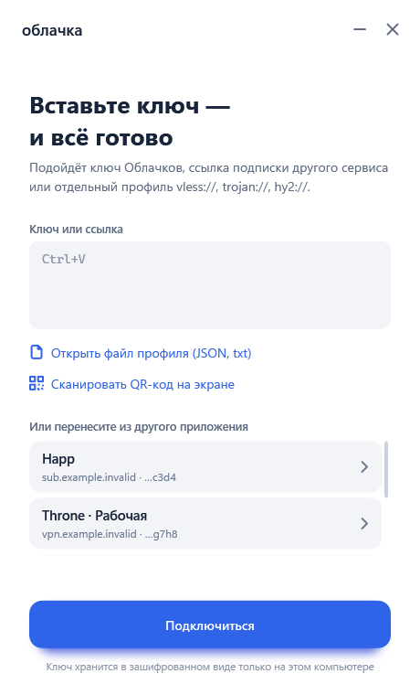
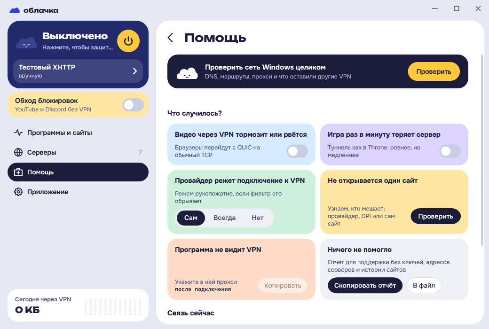
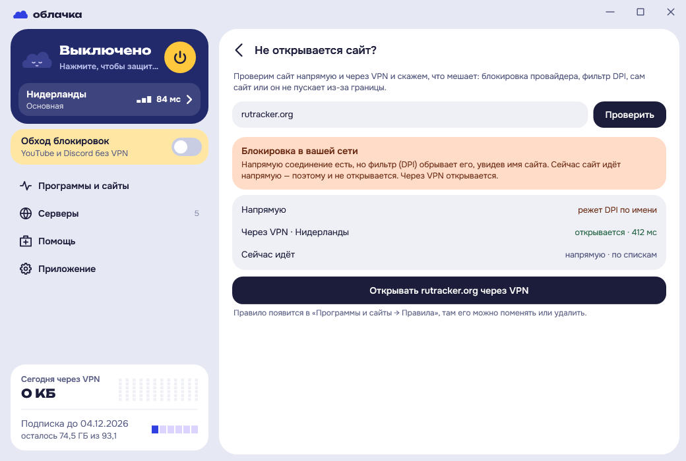
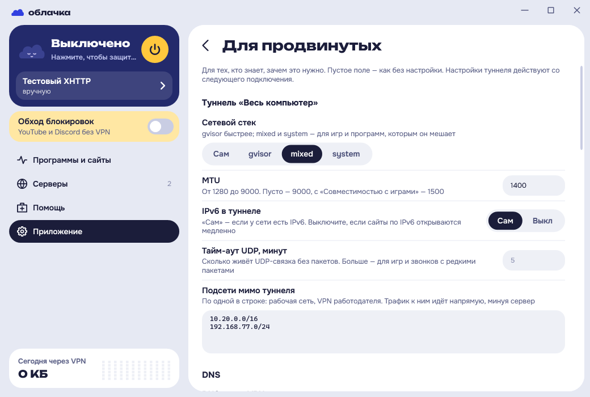
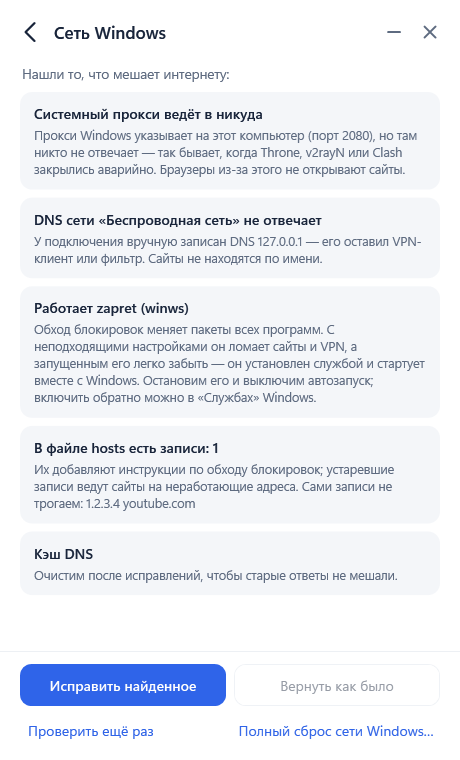
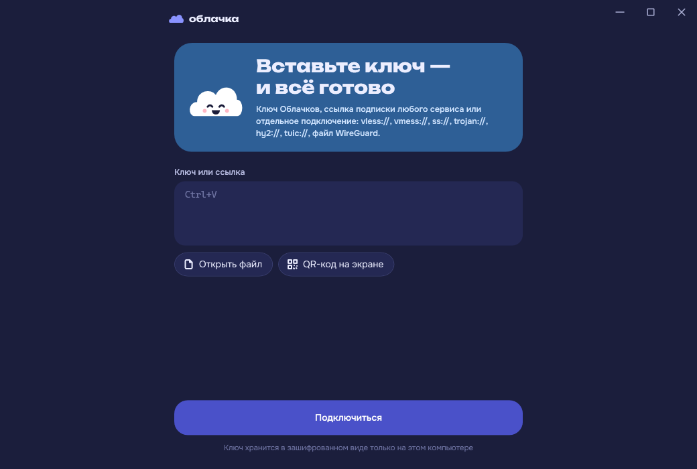

<div align="center">

# ☁️ Облачка

**VPN-клиент для Windows: вставьте ключ — и всё готово**

Xray и sing-box внутри, подписки любого сервиса, маршрутизация сайтов и программ, защита от утечек, обход блокировок без VPN

[](LICENSE)


[](https://github.com/radiypoloniy/oblachkavpn/releases)

&nbsp;&nbsp;

</div>

## Зачем

Обычные клиенты вроде v2rayN или Throne мощные, но требуют разбираться в ядрах, JSON и маршрутах. Облачка делает то же самое за одну кнопку:

- вставили ссылку подписки — серверы появились, самый быстрый выбран;
- нажали кнопку — подключено, связь проверена;
- если сервер пропал — клиент сам переключится на рабочий;
- если что-то сломалось в сети Windows — найдёт и починит.

А для тех, кто пришёл из Throne, v2rayN или Happ, есть «Для продвинутых»: стек туннеля, свой DNS, списки geosite и geoip, прокси для устройств локальной сети и многое другое.

## Возможности

**Подключение**
- Два режима: **«Весь компьютер»** (TUN, весь трафик через VPN) и **«Только браузеры»** (системный прокси).
- **Защита от утечек**: в режиме «Весь компьютер» фильтры Windows (WFP) не выпускают трафик мимо туннеля, даже если ядро упало. Если их снимет кто-то другой, служба за секунду поставит их заново.
- Состояние видно сразу: карточка-погода в боковой колонке — ночь, когда выключено, ясное небо, когда защищено, закат, когда связи нет.
- **Автовыбор** подключается к лучшему серверу по задержке и скорости через сервер и не прыгает между похожими. При обрыве переходит на рабочий.
- **«Подобрать лучшее»** проверяет лучшие серверы с разными настройками, которые сервер не видит: отпечаток TLS, нарезку рукопожатия против DPI, скорость Hysteria2 по каналу. Оставляет только то, что стабильно и заметно быстрее, и показывает итог «было → стало» с кнопкой «Вернуть как было».
- Связь проверяется так же, как ходят программы: если ядро отвечает, а сайты не открываются, Облачка пересоберёт туннель, а не будет показывать «Защищено».
- Сеть всегда возвращается в исходное состояние: после выхода, сбоя, перезагрузки и выключения компьютера, в том числе с «быстрым запуском» Windows.
- Видно, с какой страны и с какого адреса вас видят сайты, скорость в реальном времени и трафик за день.

**Подписки и серверы**
- Подписки любого сервиса: Base64-список ссылок, Xray JSON, sing-box JSON, Clash / Mihomo YAML.
- Протоколы: **VLESS** (TCP, XHTTP, WebSocket, gRPC, HTTPUpgrade; TLS и REALITY), **Trojan**, **VMess**, **Shadowsocks** (AEAD и 2022), **Hysteria2**, **TUIC**, **AnyTLS**, **WireGuard** и **AmneziaWG** (файлы `.conf`, в том числе AmneziaWG 2.0).
- **Несколько подписок сразу**, у каждой своя вкладка. Отдельные ссылки собираются во «Вручную», их настройку можно поправить прямо в приложении — перед сохранением её проверит ядро.
- Трафик и срок подписки, резервные адреса, автообновление, «Скрыть лишние» — неответившие серверы и повторы.
- Добавление по ссылке, файлу, **QR-коду с экрана** и ссылкам `oblachka://` из браузера.
- **Перенос из других клиентов** при первом запуске: Happ, Throne, Hiddify, v2rayN, NekoBox, v2RayTun, FlClash, Clash Verge.
- **Бесплатные серверы на свой риск**: по желанию и после предупреждения — серверы из открытых списков, без незашифрованных сайтов.

**Программы и сайты**
- **«Сейчас в сети»**: какие программы выходят в интернет, через VPN или напрямую, с какими сайтами они на связи и с какой скоростью. Правило можно поставить программе целиком, отдельному её файлу (игра через VPN, лаунчер напрямую) или сайту — оно действует сразу, без переподключения.
- **Правила сайтов**: домены, подсети (`10.20.0.0/16`) и порты (`port:27015-27030`) — напрямую, через VPN или блокировать. **Наборы правил** («Дом», «Работа», «Игры») переключаются одной кнопкой, правила можно выгрузить в файл и загрузить обратно.
- «Российские сайты напрямую» и правила маршрутизации сервиса (формат Happ) по спискам geosite/geoip.
- **Локальная сеть напрямую**: принтер, NAS и файлы по сети — мимо VPN.
- Игры, запущенные до включения VPN, не теряют связь, а Облачка предупредит про них.

**Обход блокировок без VPN**
- **YouTube и Discord без VPN** через встроенный [zapret](docs/zapret.md): стратегия подбирается сама для вашей сети, набор Flowseal обновляется автоматически. Работает в обоих режимах.
- **Обход DPI** для самого VPN: рукопожатие с сервером уходит частями, и фильтр не видит в нём имя сайта.

**Помощь**
- **«Что случилось?»** — у каждой беды своё средство: видео тормозит, игра теряет сервер, провайдер режет VPN, программа не видит VPN.
- **«Не открывается сайт?»** проверяет сайт напрямую и через VPN, объясняет, что мешает (блокировка провайдера, DPI, сайт не пускает из-за границы, сайт упал), и одной кнопкой добавляет правило, которое это чинит.
- **«Сеть Windows»** находит то, что ломает интернет, — брошенный прокси от упавшего клиента, «мёртвый» DNS, работающий zapret, записи в hosts — и исправляет с возможностью вернуть как было.
- **«Сообщить о проблеме»**: отчёт для поддержки без ключей, адресов серверов и истории сайтов.

**Для продвинутых**
- Стек туннеля (gvisor, mixed, system), MTU, IPv6, тайм-аут UDP, подсети мимо туннеля.
- Свой DNS через VPN (DoH) и DNS для сайтов «напрямую».
- **Свои списки geosite и geoip**: напрямую, через VPN, блокировать.
- Отпечаток TLS, форма фрагментации, User-Agent подписок, свой адрес проверки связи, порог автовыбора.
- Постоянный порт локального прокси и **прокси для устройств локальной сети** с логином и паролем: телефон или приставка выходят через VPN этого компьютера.
- Горячие клавиши (Ctrl+Alt+V — VPN, Ctrl+Alt+B — обход блокировок, Ctrl+Alt+O — окно), журнал ядра туннеля.

**Приложение**
- Светлая, тёмная и системная тема, трей с быстрой сменой сервера.
- Резервная копия настроек в файл — для переезда на другой компьютер.
- **Обновление без переустановки**: новая версия скачивается с GitHub, проверяется по SHA256 и подписи ключом разработчика и ставится в пару кликов. Без подписи обновление не ставится, даже если релиз выложен.

<table>
<tr>
<td align="center"><br><sub>Первый запуск и перенос из других клиентов</sub></td>
<td align="center"><br><sub>Помощь: от беды к средству</sub></td>
<td align="center"><br><sub>«Не открывается сайт?»</sub></td>
</tr>
<tr>
<td align="center"><br><sub>Для продвинутых</sub></td>
<td align="center"><br><sub>Починка сети Windows</sub></td>
<td align="center"><br><sub>Тёмная тема</sub></td>
</tr>
</table>

## Установка

1. Скачайте `Oblachka-setup-….exe` со страницы [Релизы](https://github.com/radiypoloniy/oblachkavpn/releases).
2. Запустите. Установщику нужны права администратора: он ставит сетевую службу для режима «Весь компьютер».
   Дальше Облачка обновляется сама: «Приложение → Обновления».
3. Программа пока не подписана, поэтому Windows может показать «Windows защитила ваш компьютер». Нажмите **«Подробнее» → «Выполнить в любом случае»**. Сверить файл можно по SHA256 из описания релиза.

Требования: Windows 10 (1809+) или Windows 11, x64. Ставить .NET не нужно, он внутри.

## Как пользоваться

1. Вставьте ссылку подписки или ключ на первом экране. Если подписка уже есть в другом клиенте, нажмите её в списке «Или перенесите из другого приложения».
2. Нажмите кнопку в карточке слева. Сервер по умолчанию — «Автовыбор»; другой сервер — в «Серверах».
3. Режим «Весь компьютер» или «Только браузеры» — вверху «Программ и сайтов». Там же видно, куда идёт каждая программа, а «Правила сайтов и программ» — внизу.
4. YouTube и Discord без VPN — карточка «Обход блокировок» под статусом.

Если интернет пропал при включённой Облачке, выключите VPN кнопкой в карточке: обычная сеть вернётся сразу. Если окно упало, а сеть закрыта, — «Помощь → Восстановить сеть» или перезагрузка.

Если интернет не работает даже без VPN, откройте «Помощь → Проверить сеть Windows целиком».

## Конфиденциальность

- Подписки и настройки хранятся только на вашем компьютере и зашифрованы средствами Windows (DPAPI) для вашей учётной записи.
- Клиент ходит в сеть к вашей подписке и выбранным серверам; на проверочные сайты (microsoft.com, cloudflare.com, speed.cloudflare.com для скорости) — через сервер; на GitHub — за обновлениями, набором zapret, базами geosite/geoip и, если вы их включили, списками бесплатных серверов; на flagcdn.com — за флагами стран.
- Подписке сервиса Облачка передаются случайный идентификатор устройства, версия Windows и модель компьютера: по ним работает лимит устройств. Сторонним подпискам уходит свой идентификатор для каждого сервиса, его можно отключить в «Для продвинутых». Серийных номеров и личных данных в запросе нет.
- Раз в 12 часов клиент спрашивает у GitHub, нет ли новой версии (отключается в «Приложение → Обновления»). В запросе нет ничего, кроме версии клиента.
- Никакой телеметрии и аналитики нет.

## Сборка из исходников

```powershell
git clone https://github.com/radiypoloniy/oblachkavpn.git
cd oblachkavpn
.\build.ps1              # скачает ядра (SHA256 сверяется) и соберёт out\app
.\test.ps1               # ~350 проверок: разбор, сеть, служба, интерфейс
.\build-installer.ps1    # установщик в dist\ (нужен Inno Setup 6)
```

Нужен [.NET SDK 10](https://dotnet.microsoft.com/download/dotnet/10.0). Подробности — в [docs/development.md](docs/development.md).

## Структура репозитория

```text
src/
  App/            точка входа, ссылки oblachka://, пути данных
  Window/         главное окно по частям (подключение, импорт, серверы, правила, трей)
  Views/          экраны в XAML
  UI/             диалоги, темы, флаги
  Themes/         токены оформления (собираются из theme/tokens.json)
  Profiles/       ссылки, подписки, группы, сохранение, перенос из других клиентов
  Core/           управление ядрами Xray / sing-box, замеры, автовыбор, «Подобрать лучшее»
  Routing/        правила сайтов и программ, geosite / geoip
  Network/        сетевая служба, TUN, защита WFP, системный прокси
  NetworkDoctor/  проверка и починка сети Windows
  Qr/             распознавание QR-кодов
core/             своё ядро туннеля (sing-box со встроенным Xray и AmneziaWG)
tests/            самопроверки и стенды (Oblachka.Tests.exe)
installer/        сценарий Inno Setup
scripts/          загрузка ядер и проверки кода
theme/            единый источник оформления
vendor/           лицензии и происхождение ядер
zapret/           манифест набора Flowseal
docs/             документация
```

## Документация

- [Как устроена Облачка](docs/architecture.md)
- [Разработка, сборка и проверки](docs/development.md)
- [Сетевая служба и граница доверия](docs/network-service.md)
- [Заголовки подписки для провайдеров](docs/provider-headers.md)
- [Установщик](docs/installer.md)
- [zapret: YouTube и Discord без VPN](docs/zapret.md)

## Лицензия

Код Облачки распространяется по лицензии [GNU GPL v3](LICENSE).

Внутри используются [Xray-core](https://github.com/XTLS/Xray-core) (MPL-2.0), [sing-box](https://github.com/SagerNet/sing-box) (GPL-3.0) и [amneziawg-go](https://github.com/amnezia-vpn/amneziawg-go) (MIT). Версии, контрольные суммы и лицензии — в [THIRD-PARTY.md](THIRD-PARTY.md).
